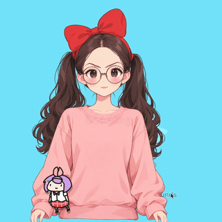

# 半身皮套 skill

[English](README.md) | 简体中文

一张立绘或一段角色描述，交给 AI Agent（如 Claude Code），一步步做出能在 VTube Studio 里直播用的半身 Live2D 皮套。不用手动建模，不开 Cubism Editor，不调网格。

 

 

## 能做什么

- 转头左右、上下（±30），歪头时身体跟着倾斜；身体跟随和呼吸
- 眨眼、单眼眨眼，眼珠跟随，眉毛上下，张嘴说话、嘴角笑
- 头发分段摆动：刘海、两侧（发根和发梢两段）、后发或发髻；双马尾每条从发绳往下单独摆；过肩长发在肩膀以下跟身体。刘海可有可无，两侧头发可以别在耳后
- 项链吊坠跟着身体摆，耳坠挂在耳垂上摆
- 眼镜跟着脸转
- 快捷键：笑眼、O 型嘴、急眼、困扰，招手、摊手、指向三个手势，脸红

做不到：大角度转头、全身、手臂跟着摄像头连续动。做出来的是 VTS 直接用的模型文件（.moc3），不是 Cubism Editor 的工程文件，Editor 打不开。精修级的效果（更细的物理、更多表情）要把拆好的图层导进 Cubism Editor 重新绑定。适合正面半身的角色，短发、过肩长发、双马尾都可以。

## 立绘会怎么调整

Agent 会把你给的立绘或描述重画成方便拆图层的版本，你确认后再往下做。脸、发色、眼睛、服装、配色和画风保持原样，下面这些会调整：

- **构图**：正面半身，从头顶到腰，纯白底；双手垂在身体两侧，和身体之间留空隙，手里不拿东西。三个手势都从这个姿势改出来。
- **刘海**：可有可无。有刘海时是齐刘海，停在眉毛以上，两条眉毛完整露出，眉毛才能单独动；没有刘海时露出整个额头。
- **两侧头发**：二选一。脸两侧各一片顺直的头发，挡住耳朵、到下巴为止，转头时单独摆动；或者全部别在耳后，露出耳朵。
- **长发**：垂在脖子、肩膀和背后，只从脖子两侧和手臂外侧露出来，不搭在肩膀前、胸前或手臂上。
- **双马尾**：在耳朵后上方扎起，垂在肩膀后面。
- **脖子**：下巴和领口之间露出一段脖子，转头时下巴从脖子前面滑过。
- **颜色和光**：头发和皮肤颜色分开，头发带细描边；平光，没有投影。投影在部件动起来后会错位。
- **饰物**：眼镜保留，改成细框、镜片透明没有反光；耳坠保留，头发要别在耳后；去掉颈圈和垂下的飘带；项链只留贴在衣服上的细链，最多一个吊坠；帽子戴在头顶，不遮额头和眉毛。
- **腮红**：脸颊上带一层淡腮红。

清单之外的发型和饰物（兽耳、辫子等），可以让 Agent 在这个 skill 上扩展：补出图规则，改拆层和绑定的代码，再在 VTS 里验收。

## 你要做的三件事

1. 确认 Agent 生成的立绘。
2. 同意把立绘传到 [See-through](https://github.com/shitagaki-lab/see-through) 拆图层（Hugging Face，备用魔搭；在自己的 Mac 上跑时不用传）。
3. 在 VTube Studio 里按清单看效果，回复“通过”或“不通过：哪里不对”。

## 需要什么

- 一个能运行 skill 的 AI Agent，如 Claude Code
- Python 3.10+，ffmpeg
- ChatGPT 账号：用 Codex 命令行出图（ChatGPT 桌面版自带）。也可以换成其他能改图的图像工具（还没用它完整做过一个角色）
- See-through，以下至少一种：
  - Hugging Face 免费账号（首选，几分钟一次）：建一个 Read token，放进环境变量 `HF_TOKEN` 或 `~/.cache/huggingface/token`。不登录时每天的免费额度不一定够跑一次，登录后约每天 1～2 次
  - 魔搭 ModelScope 账号（备用，免费，要排队，一次可能半小时，分辨率更高）：建一个访问令牌，放进环境变量 `MODELSCOPE_API_TOKEN` 或 `~/.cache/modelscope/token`
  - 或者在自己的 Mac 上跑 See-through（可选，不传图，不限次数）：Apple 芯片、24 GB 内存上验证过，一张立绘约 21 分钟。装法见 [references/出图.md](references/出图.md) 的“本机跑 See-through”
- VTube Studio
- Live2D Cubism Core：装 Cubism Editor 自带，或免费下载 Cubism SDK for Native

macOS 上验证过；Windows 未验证。

## 开始

1. 把这个仓库放进 Agent 的 skill 目录，例如 Claude Code：`git clone https://github.com/bellisji233/live2d-halfbody-skill ~/.claude/skills/live2d-halfbody`
2. 安装依赖：`pip install -r requirements.txt`
3. 对 Agent 说：“用这张立绘做一个 VTube Studio 皮套”，附上图片路径；或者描述你想要的角色。

一个角色出图 19～24 张、See-through 一次，从立绘到装进 VTS 约一小时，见[常见问题](#常见问题)。

## 常见问题

### 从立绘到装进 VTS 要多久？

参考第三个角色（眼镜）的耗时：

| 步骤 | 耗时 | 谁来做 |
|---|---|---|
| 1. 出立绘（Codex） | 约 1.5 分钟 | Agent |
| 2. 确认立绘 | — | 你 |
| 3. 出 14～19 张变体图：闭眼、张嘴、拿掉头发等（Codex，每张约 1.5 分钟） | 约 20～30 分钟 | Agent |
| 4. See-through 拆图层（Hugging Face，和第 3 步同时跑） | 约 5 分钟 | Agent，上传前先问你 |
| 5. 拆图层，和 See-through 的结果合成 | 约 2 分钟 | Agent |
| 6. 脸红和三个手势，再出 4 张图 | 约 7 分钟 | Agent |
| 7. 估算位置、检查素材、生成模型 | 约 1 分钟 | Agent |
| 8. 自查、装进 VTS | 1～2 分钟 | Agent |
| 9. 在 VTS 里验收 | 5～10 分钟 | 你 |

机器时间约 30～45 分钟，加上确认和验收，顺利的话一小时内能装进 VTS。变体图的张数看角色有没有帽子或发饰、刘海、耳前的侧发和挂件。

Codex 或 See-through 额度用完时会停在当前步骤，额度恢复后接着跑，已经出好的图不会重出。

## 许可

MIT，见 [LICENSE](LICENSE)。`rigkit/vendor/py-moc3` 为 MIT，许可随附。Live2D Cubism Core 不随本 skill 分发，按 Live2D 的许可使用。
