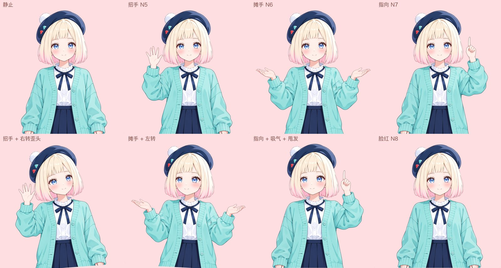

# 半身皮套 skill

[English](README.md) | 简体中文

一张立绘或一段角色描述，交给 AI Agent（如 Claude Code），一步步做出能在 VTube Studio 里直播用的半身 Live2D 皮套。不用手动建模，不开 Cubism Editor，不调网格。

## 能做什么

- 转头左右、上下（±30），歪头时身体跟着倾斜；身体跟随和呼吸
- 眨眼、单眼眨眼，眼珠跟随，眉毛上下，张嘴说话、嘴角笑
- 头发分段摆动：刘海、两侧（发根和发梢两段）、后发或发髻；过肩长发在肩膀以下跟身体
- 项链吊坠跟着身体摆
- 快捷键：笑眼、O 型嘴、急眼、困扰，招手、摊手、指向三个手势，脸红

做不到：大角度转头、全身、手臂跟着摄像头连续动。还没验证：双马尾（现有头发规则只覆盖刘海、到下巴的两侧、后发和发髻）。做出来的是 VTS 直接用的模型文件（.moc3），不是 Cubism Editor 的工程文件，Editor 打不开。精修级的效果（更细的物理、更多表情）要把拆好的图层导进 Cubism Editor 重新绑定。适合正面半身的角色，短发或过肩长发都可以。

## 立绘会怎么调整

Agent 会把你给的立绘或描述重画成方便拆图层的版本，你确认后再往下做。脸、发色、眼睛、服装、配色和画风保持原样，下面这些会调整：

- **构图**：正面半身，从头顶到腰，纯白底；双手垂在身体两侧，和身体之间留空隙，手里不拿东西。三个手势都从这个姿势改出来。
- **刘海**：齐刘海，停在眉毛以上，两条眉毛完整露出，眉毛才能单独动。没有刘海的角色目前也会加上刘海。
- **两侧头发**：脸两侧各一片顺直的头发，挡住耳朵，到下巴为止，转头时单独摆动。
- **长发**：垂在脖子、肩膀和背后，不搭在肩膀前、胸前或手臂上。
- **脖子**：下巴和领口之间露出一段脖子，转头时下巴从脖子前面滑过。
- **颜色和光**：头发和皮肤颜色分开，头发带细描边；平光，没有投影。投影在部件动起来后会错位。
- **饰物**：去掉眼镜、耳环、颈圈和垂下的飘带；项链只留贴在衣服上的细链，最多一个吊坠；帽子戴在头顶，不遮额头和眉毛。
- **腮红**：脸颊上带一层淡腮红。

清单之外的发型和饰物（双马尾、眼镜等），可以让 Agent 在这个 skill 上扩展：补出图规则，改拆层和绑定的代码，再在 VTS 里验收。

## 你要做的三件事

1. 确认 Agent 生成的立绘。
2. 同意把立绘传到 [See-through](https://github.com/shitagaki-lab/see-through) 拆图层（Hugging Face，备用魔搭）。
3. 在 VTube Studio 里按清单看效果，回复“通过”或“不通过：哪里不对”。

## 需要什么

- 一个能运行 skill 的 AI Agent，如 Claude Code
- Python 3.10+，ffmpeg
- ChatGPT 账号：用 Codex 命令行出图（ChatGPT 桌面版自带）
- See-through 用的账号，至少一个：
  - Hugging Face 免费账号（首选，几分钟一次）：建一个 Read token，放进环境变量 `HF_TOKEN` 或 `~/.cache/huggingface/token`。不登录时每天的免费额度不一定够跑一次，登录后约每天 1～2 次
  - 魔搭 ModelScope 账号（备用，免费，要排队，一次可能半小时，分辨率更高）：建一个访问令牌，放进环境变量 `MODELSCOPE_API_TOKEN` 或 `~/.cache/modelscope/token`
- VTube Studio
- Live2D Cubism Core：装 Cubism Editor 自带，或免费下载 Cubism SDK for Native

macOS 上验证过；Windows 未验证。

## 开始

1. 把这个仓库放进 Agent 的 skill 目录，例如 Claude Code：`git clone https://github.com/bellisji233/live2d-halfbody-skill ~/.claude/skills/live2d-halfbody`
2. 安装依赖：`pip install -r requirements.txt`
3. 对 Agent 说：“用这张立绘做一个 VTube Studio 皮套”，附上图片路径；或者描述你想要的角色。

一个角色从立绘到装进 VTS，出图 22～24 张，See-through 一次，生成模型几分钟。

## 许可

MIT，见 [LICENSE](LICENSE)。`rigkit/vendor/py-moc3` 为 MIT，许可随附。Live2D Cubism Core 不随本 skill 分发，按 Live2D 的许可使用。
